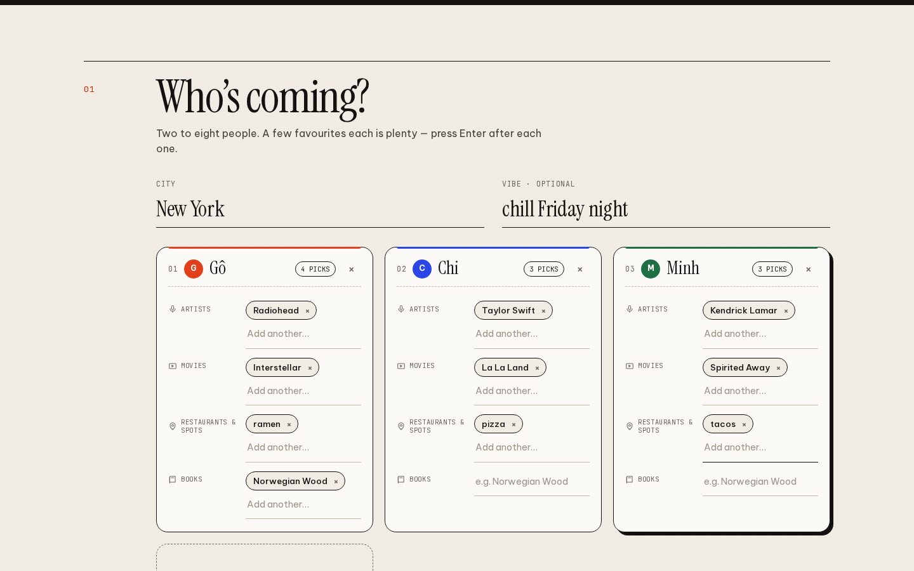
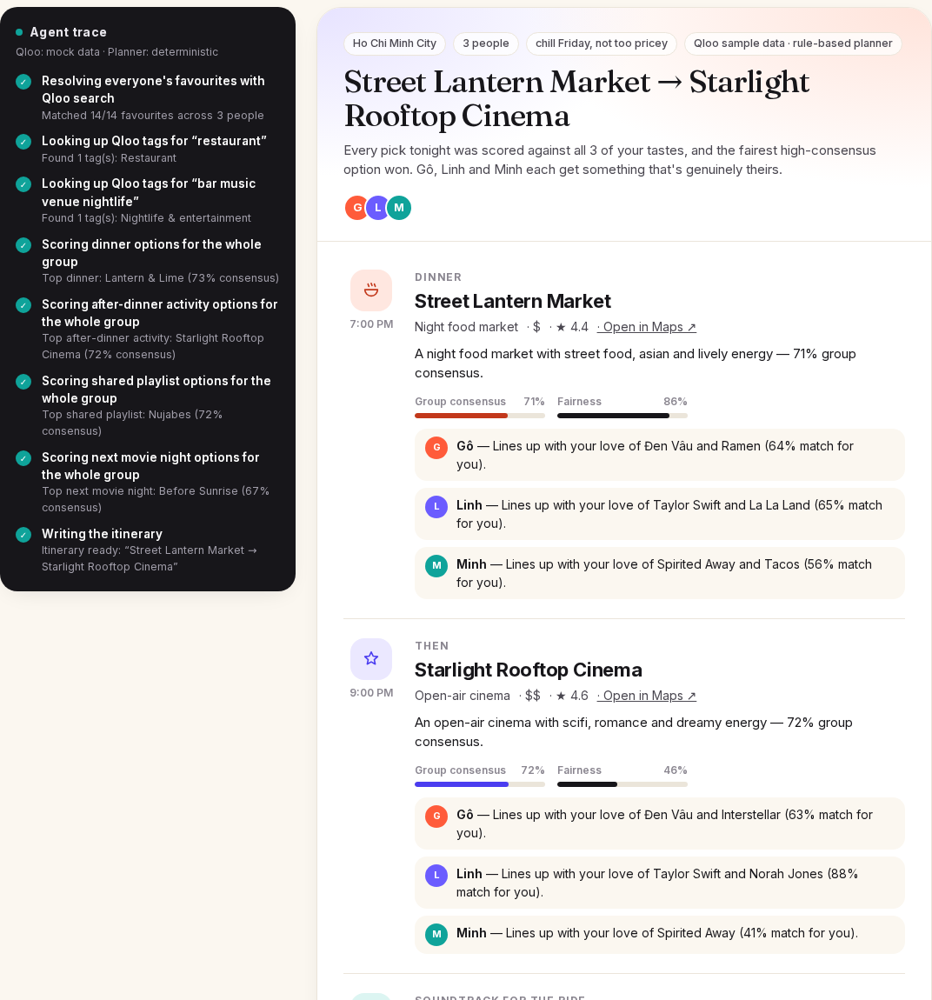
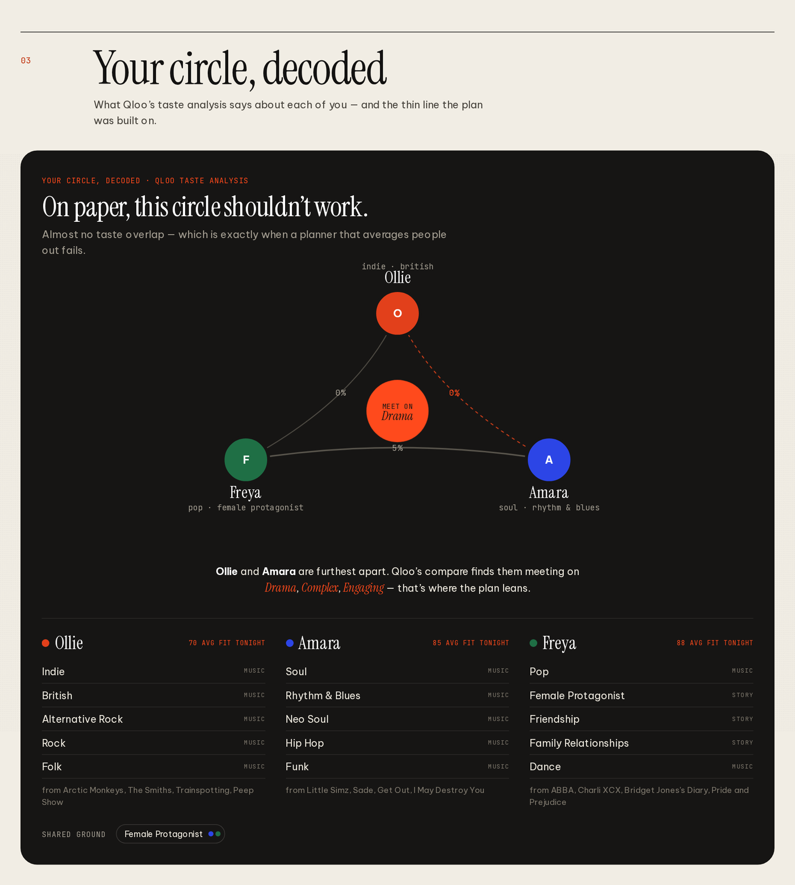
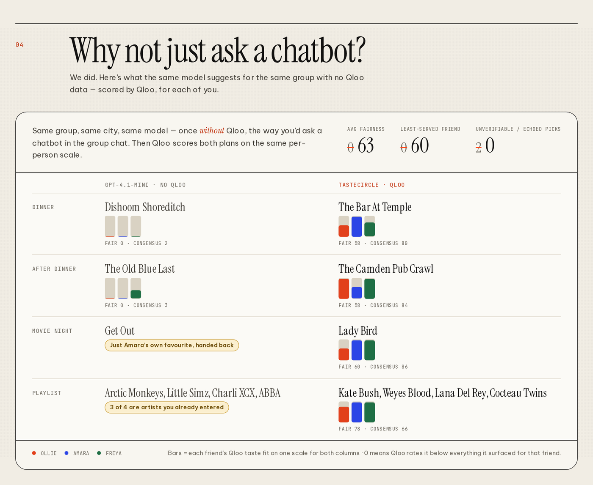

# TasteCircle

**One night out. Everyone’s taste.**

Every group chat has the same thread: *“where are we going tonight?” — “anywhere’s fine” — “not sushi again”*. The plan goes to whoever gives up last, and a chatbot just averages the loudest opinions.

TasteCircle is an AI agent that plans a night out for friends whose tastes clash. Everyone drops in a few favourites — music, films & TV, books & podcasts, places. The agent uses [Qloo’s Taste AI](https://www.qloo.com) to find the **dinner → after-plan → playlist → next movie night** the whole group overlaps on, checks its own work with a fairness critic, explains every pick *for each friend* from Qloo’s explainability, and takes change requests (“somewhere quieter”, “Minh is vegetarian”, “move it to Saigon”) by going back to Qloo — never to its imagination.

Built for the [Qloo Agentic Hackathon](https://qloo.devpost.com/).

- **Live app:** https://tastecircle-navy.vercel.app — try a sample circle (New York, London, Tokyo, Ho Chi Minh City) → *Plan our night*
- **Static demo** (sample data, runs in your browser, no server): https://phamnghia1508.github.io/DichVuCamDo/
- **License:** [MIT](./LICENSE)

| The group-chat problem | The agent at work | Your circle, decoded | Why not just ask a chatbot? |
|---|---|---|---|
|  |  |  |  |

<sub>Screenshots from the deployed app (live Qloo API + gpt-4.1-mini agent).</sub>

---

## What it does

1. **Build the circle.** Each friend adds favourites in four rows that search six Qloo entity types: Music (`artist`), Film & TV (`movie`, `tv_show`), Books & podcasts (`book`, `podcast`), Food & places (`place`). Or send an **invite link**: the circle so far travels in the URL fragment, each friend adds themselves and passes it on — no accounts, no database.
2. **Watch the agent work.** Every Qloo call, every decision and every critic note streams into the agent log.
3. **Get a programme with a reason for everyone.** Each stop shows a per-friend **taste-fit bar** and the favourite Qloo’s explainability actually credits for *that* friend (“via Phoebe Bridgers”), plus consensus and fairness.
4. **Talk to the plan.** “Swap the bar for somewhere quieter”, “make it cheaper”, “Priya is vegetarian”, “we want karaoke”, “move it to London”. The agent re-queries Qloo for the stops that must change, keeps the rest, and says what changed.
5. **See your circle decoded** — a taste map from Qloo’s taste analysis: each friend’s fingerprint, how far apart each pair is, and the bridge Qloo’s compare endpoint finds between the two furthest apart.
6. **See why Qloo matters.** The same model plans the same night *without* Qloo, then Qloo audits both plans on the same per-person scale: unverifiable venues, venues in the wrong city, “recommendations” that are just someone’s own favourite handed back, and how fair each plan really is.
7. **Send it to the group** — the whole plan lives in a compressed URL fragment (`/plan#…`).

## How it works

```
                     ┌──────────────────────── Phase A · no LLM tokens, parallel through a 5 req/s Qloo queue ───────────────────────┐
 friends’ favourites │ GET /search ×N  ──►  GET /v2/insights filter.type=urn:tag (per friend)  ──►  GET /v2/insights/compare       │──► taste map
   (free text)       │  (6 entity types)     taste fingerprints                                     (furthest pair → “bridge”)    │
                     │                 └─►  per slot: GET /v2/insights (everyone’s signal, city, category tags, union)           │
                     │                       → category & constraint checks → pool                                              │
                     │                      GET /v2/insights per friend (filter.results.entities = pool, explainability)        │──► scored shortlists
                     └─────────────────────────────────────────────────────────────────────────────────────────────────────────────┘
                     ┌──────────────────────── Phase B · OpenAI tool-calling agent (gpt-4.1-mini) ─────────────────────────────────┐
                     │ reads shortlists + taste map → search_slot(constraints) · find_bridge(slot, friend) · set_city(city)        │
                     │ → finalize_itinerary ──► CRITIC: “Maya has 12% fit on the after-plan” → rejected → find_bridge → finalize │
                     │ → writer pass (gpt-4.1): every reason must name a favourite Qloo credited to that friend, or it’s dropped │
                     └─────────────────────────────────────────────────────────────────────────────────────────────────────────────┘
                      deterministic planner (no key / LLM failure / time budget): same critic + bridge, templated copy, no repeated Qloo work
```

### Qloo endpoints used

| Endpoint | What for |
|---|---|
| `GET /search` (`types=urn:entity:artist`, `movie,tv_show`, `book,podcast`, `place`) | resolve every favourite to a Qloo entity. Free-text place inputs (“ramen”) are only accepted when the match actually contains the words, searched in the user’s city first. Also used to audit the plain-LLM baseline. |
| `GET /v2/insights` `filter.type=urn:entity:place` + `filter.location.query` + `filter.tags` (`urn:tag:category:place:*`, `operator.filter.tags=union`) + `filter.exclude.tags` (`noise_level:loud`) + `filter.price_level.max` + `feature.explainability` | dinner and after-plan candidate pools for the whole group, with constraints |
| `GET /v2/insights` `filter.type=urn:entity:artist` / `urn:entity:movie` | playlist and movie-night pools |
| `GET /v2/insights` with `filter.results.entities` | each friend’s own affinity + explainability for every candidate (and for the plain-LLM picks) |
| `GET /v2/insights` `filter.type=urn:tag` + `filter.tag.types` | each friend’s taste fingerprint (music genres, media genres, story keywords) |
| `GET /v2/insights/compare` | what the two furthest-apart friends have in common — the taste bridge |
| `GET /v2/tags` | venue-type tags for change requests (“karaoke”, “jazz”, “comedy”…) |

Never `/recs` or `/recommendations`.

### Scoring

For each slot Qloo returns a pool for the blended group signal; each friend is then scored on that pool with their own favourites only. Qloo affinities are compressed (most land between 0.7 and 0.9), so each friend’s raw affinities are put on a **taste-fit** scale anchored to their pool: the weakest candidate ≈ 36, the strongest ≈ 93, and anything Qloo rates below the whole pool drops towards 0.

- `consensus = 0.45 · groupFit + 0.55 · harmonicMean(friendFits)` — one unhappy friend sinks a pick
- `fairness = min(friendFit) / max(friendFit)`

**Explainability, attributed truthfully.** The group call’s explainability splits weight almost evenly across everyone’s inputs, so it can’t say *whose* taste a pick serves. TasteCircle uses the **per-friend** call instead: its explainability ranks that friend’s *own* favourites for each candidate, and only those (top 1–2, ≥70% of the strongest) become the friend’s drivers. A friend with no credited favourite gets an honest “stretch pick”, not an invented reason.

**Category checks.** Qloo place results mix in department stores, wedding venues, university cafeterias, hotels and libraries. Every candidate is checked against its Qloo category tags for the slot (dinner = somewhere to eat; after-plan = bar, venue, show; hotels only when tagged as a bar), and dropped ones are listed in the agent log.

### The agent loop

- **Tools:** `search_slot(slot, price_max, quiet, dietary, dietary_for, activity_type)`, `find_bridge(slot, member)`, `set_city(city)` (refinement), `finalize_itinerary(...)`.
- **Bridge search:** seeds a Qloo pool from the left-out friend’s favourites only, scores it for everyone and places it on the slot’s existing fit scale; refused when that friend already has a ≥50% fit in the top picks.
- **Critic:** `finalize_itinerary` rejects a draft where someone has <25% fit on a pick with <40% fairness and no bridge was tried. The model sees the rejection and goes back to Qloo.
- **Refinement:** the plan carries the circle’s resolved entity IDs, constraints, taste map and fit scales, so a change request needs no re-resolution; obvious constraints (price, quiet, dietary, city aliases like Saigon → Ho Chi Minh City) are pre-parsed and applied to every search.
- **Writer pass:** a stronger model (gpt-4.1) rewrites title, summary, blurbs and reasons from the same facts; any reason that doesn’t name a Qloo-credited favourite for that friend is discarded.
- **Budgets:** 7 turns max, 60 s LLM budget (finalize forced near the end), 14 s writer budget; Qloo client: ≤4 in flight, ≥210 ms between starts (the hackathon key allows 5 req/s), 429/5xx retry with backoff, 30-min in-memory cache. Typical live plan: **18–27 s**; refinement **7–11 s**.

### LLM alone vs. with Qloo

`POST /api/baseline` asks the same model, with no Qloo data, for the same night (it sees the names of everyone’s favourites, like a friend in the chat would). Then Qloo audits it: does the venue exist in Qloo’s graph *in that city*, is a “recommendation” just someone’s own input, and how does each friend score it on the same fit scale as the Qloo-grounded plan. In our runs the plain LLM regularly suggested venues Qloo can’t find in the city (or finds in another country), handed back 3 of 4 entered artists as the “playlist”, and picked places Qloo rates below everything it surfaced for at least one friend.

## Run it locally

Requires Node 18.18+.

```bash
git clone https://github.com/PhamNghia1508/DichVuCamDo.git
cd DichVuCamDo
npm install
cp .env.example .env.local   # optional: fill in keys; empty = mock mode
npm run dev                  # http://localhost:3000
```

Pick a sample circle → **Plan our night**.

```bash
npm test               # mock-mode end-to-end (plan, critic rule, bridge, refinement, baseline, category checks)
                       # + scripted fake-OpenAI tests of the tool loop, critic, writer grounding and fallback
npm run typecheck
npm run build && npm start
npm run build:static   # static GitHub Pages demo into ./out (agent runs in-browser on sample data)
```

### Modes — it always runs

| | Key set | Key missing |
|---|---|---|
| **Qloo** (`QLOO_API_KEY`) | live hackathon API | **mock mode**: a hand-written sample catalog in `lib/mock/catalog.ts` (fictional venues; not Qloo data) |
| **LLM** (`LLM_API_KEY`) | tool-calling agent + writer pass | **deterministic planner**: same tools, critic and bridge search, templated copy |

### Environment variables

| Variable | Purpose |
|---|---|
| `QLOO_API_KEY` | Qloo hackathon key (sent as `X-Api-Key`, server-side only) |
| `QLOO_BASE_URL` | defaults to `https://hackathon.api.qloo.com` |
| `LLM_API_KEY` | OpenAI-compatible key with tool calling |
| `LLM_BASE_URL` | default `https://api.openai.com/v1` |
| `LLM_MODEL` | agent model, e.g. `gpt-4.1-mini` (live app) |
| `LLM_WRITER_MODEL` | writer-pass model; defaults to `gpt-4.1` on OpenAI, else `LLM_MODEL` |
| `TASTECIRCLE_LLM_BUDGET_MS` | agent time budget before the deterministic finisher takes over (default `60000`) |
| `TASTECIRCLE_FORCE_MOCK` | `1` = mock Qloo data even with a key |

`GET /api/health` reports which modes are active (never the keys).

## API

| Route | |
|---|---|
| `POST /api/plan` | `{ members, city, vibe? }` → NDJSON stream of agent events, ending with the plan |
| `POST /api/refine` | `{ plan, message }` → NDJSON stream, ending with the new plan |
| `POST /api/baseline` | `{ plan }` → plain-LLM plan audited and scored by Qloo |
| `GET /api/health` | modes |

## Project layout

```
app/
  page.tsx                 home: problem, planner (sample circles, invite), live results, taste map, versus
  plan/page.tsx            shared itinerary (plan decoded from the URL fragment)
  api/plan|refine|baseline|health
lib/
  qloo.ts                  Qloo client: /search, /v2/insights (+urn:tag), /v2/insights/compare, /v2/tags; rate-limited queue + cache; mock switch
  agent/consensus.ts       pools, per-friend scoring, fit scale, consensus/fairness, truthful drivers, bridge search
  agent/slots.ts           slot specs, Qloo category tags, category + constraint checks
  agent/tasteMap.ts        fingerprints, pairwise overlap, compare bridge
  agent/run.ts             Phase A, tool-calling loop, critic, refinement, deterministic planner
  agent/writer.ts          grounded writer pass
  agent/baseline.ts        LLM-alone baseline + Qloo audit
  agent/llm.ts             minimal OpenAI-compatible client
  presets.ts               sample circles
  mock/catalog.ts          hand-written sample catalog for mock mode
components/                GroupBuilder, AgentTrace, Itinerary (fit strips), TasteMap, Compare, Refine
scripts/                   smoke test, agent-loop tests, static build
```

## Data & keys

- Only GET requests to the hackathon base URL. Qloo responses live in server memory (30-minute cache) and are never written to disk; **no Qloo response data is committed** to this repository. `.gitignore` blocks `.env*`, `qloo-cache/` and `*.qloo.json`.
- Keys are read from environment variables on the server and never sent to the browser. Plans and invites live in URL fragments, which browsers don’t send to servers.

## License

[MIT](./LICENSE) © 2026 Phạm Nhật Nghĩa
